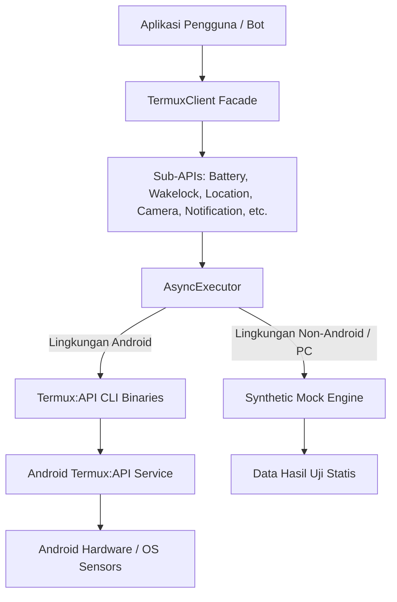

# PROJECT OVERVIEW & ARCHITECTURE: muxpy ⚡

## 1. Latar Belakang & Problem Statement
Termux adalah lingkungan terminal Linux paling tangguh di Android. Bersama paket tambahan `termux-api` dan aplikasi companion Android, developer memiliki akses ke perangkat keras Android (baterai, kamera, lokasi GPS, audio, senter, getar, notifikasi, dialog interaktif, SMS, dan wakelock).

Namun, ekosistem otomasi Python di Termux selama ini menghadapi masalah mendasar:
1. **Blocking Call Problem:** Mayoritas skrip memanggil `termux-api` menggunakan `subprocess.run()` atau `os.system()` secara synchronous. Ini memblokir event loop utama dan merusak performa bot asynchronous modern (`aiogram`, `python-telegram-bot`, `discord.py`, FastAPI).
2. **Android Background Process Killing:** Android OS secara agresif membunuh (*force kill*) skrip Python yang berjalan di latar belakang saat layar ponsel mati karena ketiadaan manajemen CPU Wakelock yang benar.
3. **Ketiadaan Tipe Data:** CLI bawaan Termux hanya me-return string JSON mentah. Developer terpaksa menulis `json.loads()` berulang-ulang tanpa bantuan autocomplete IDE atau type safety.
4. **Kesulitan Testing di Luar Android:** Menguji kode Termux di komputer lokal (Windows/macOS/Linux) selalu memicu error `command not found` karena tidak adanya binary Android.

---

## 2. Visi & Tujuan Project

### Visi
Menjadi kerangka kerja Python asynchronous standar, paling ringan (*ultra-light*), aman, dan terpercaya untuk integrasi hardware Android di Termux.

### Pilar Utama (Core Pillars)
1. **Asynchronous First:** Dibangun murni dengan `asyncio.subprocess` non-blocking untuk skalabilitas tinggi.
2. **Background Daemon Resilience (Wakelock):** Menyediakan mekanisme pengunci daya CPU (`keep_awake`) agar proses background dapat bertahan saat layar mati.
3. **PEP 561 Type-Safe Models:** Seluruh output dikonversi menjadi `dataclass` berstruktur rapi lengkap dengan autocompletion dan type hint.
4. **Zero-Dependency Mock Engine:** Mampu mendeteksi sistem operasi host dan menyediakan simulasi data sintetis otomatis untuk pengujian di laptop developer.
5. **CLI Diagnostics Tooling:** Memudahkan pengguna memeriksa seluruh metrik sistem secara instan melalui terminal (`muxpy info`).

---

## 3. Arsitektur Teknis

```
muxpy/
├── core/
│   ├── executor.py       # Asynchronous process runner (asyncio.subprocess) & Mock engine
│   ├── exceptions.py     # Hierarki exception terstandarisasi (TermuxTimeoutError, dll.)
│   └── models.py         # Base data structures
├── api/
│   ├── battery.py        # BatteryStatus & async event polling generator
│   ├── wakelock.py       # CPU Wakelock manager & keep_awake context manager
│   ├── notification.py   # Fluent NotificationBuilder (actions, sound, priority)
│   ├── location.py       # LocationInfo GPS & Network coordinate provider
│   ├── camera.py         # CameraInfo & photo snapshot capture
│   ├── volume.py         # VolumeStream levels & stream controller
│   ├── sms.py            # SmsMessage listing & SMS sending
│   ├── dialog.py         # Android GUI native dialogs (Text, Confirm, Radio, Checkbox)
│   ├── toast.py          # Android toast notification popup
│   ├── vibrator.py       # Haptic feedback duration & force vibration
│   ├── torch.py          # Camera flashlight toggle
│   ├── tts.py            # Text-To-Speech speech synthesis
│   ├── clipboard.py      # System clipboard getter & setter
│   ├── wifi.py           # WifiConnectionInfo network status
│   └── sensor.py         # Hardware sensors inspector & telemetry reader
├── cli.py                # Command-Line diagnostic tool (`muxpy info`)
├── client.py             # Facade utama: TermuxClient
└── py.typed              # Penanda kepatuhan tipe PEP 561
```

---

## 4. Diagram Alur Interaksi Komponen



---

## 5. Standar Kualitas & CI/CD
* **Matrix Testing:** Otomatis diuji pada Python 3.9, 3.10, 3.11, dan 3.12 via GitHub Actions.
* **Auto-Sync:** Terintegrasi pipeline sinkronisasi tanpa watermark bot.
* **Licensing:** Open-Source di bawah lisensi MIT untuk penggunaan komersial maupun personal.
